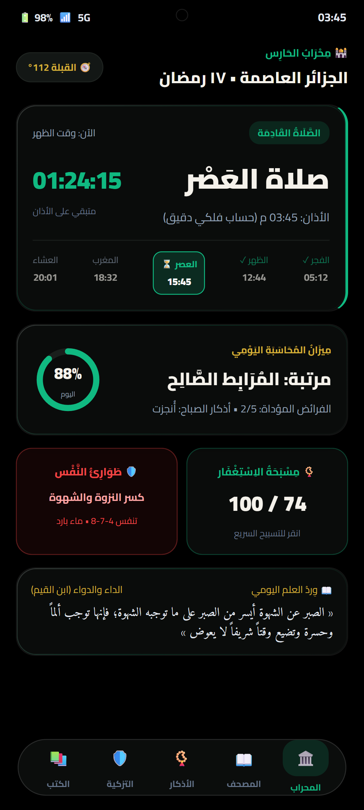
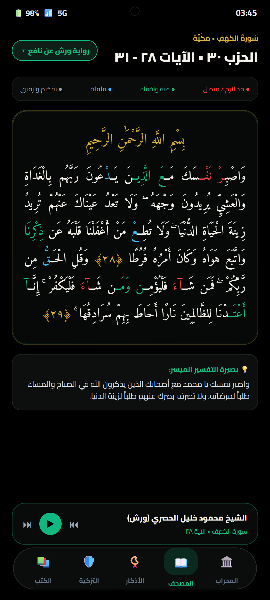
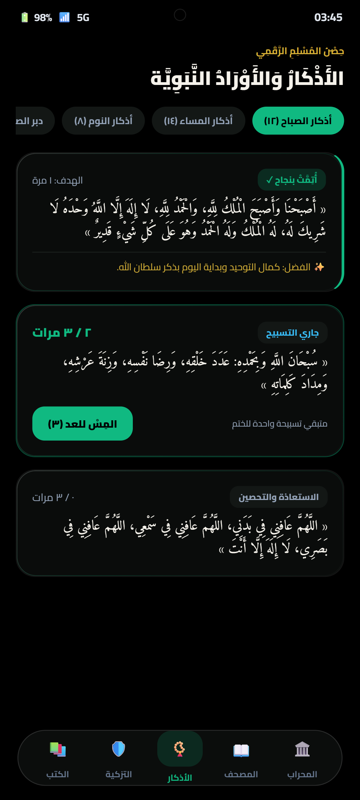
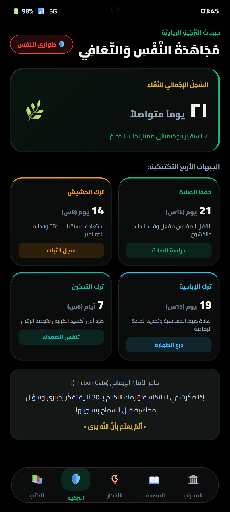
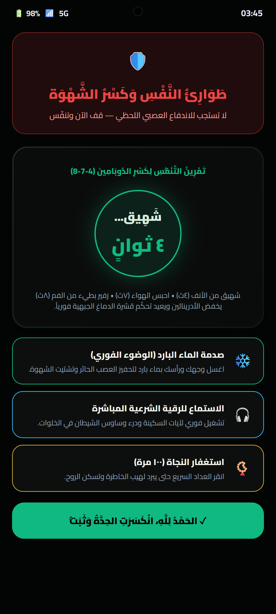
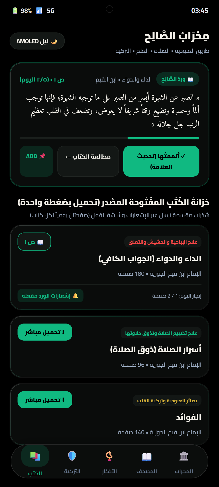
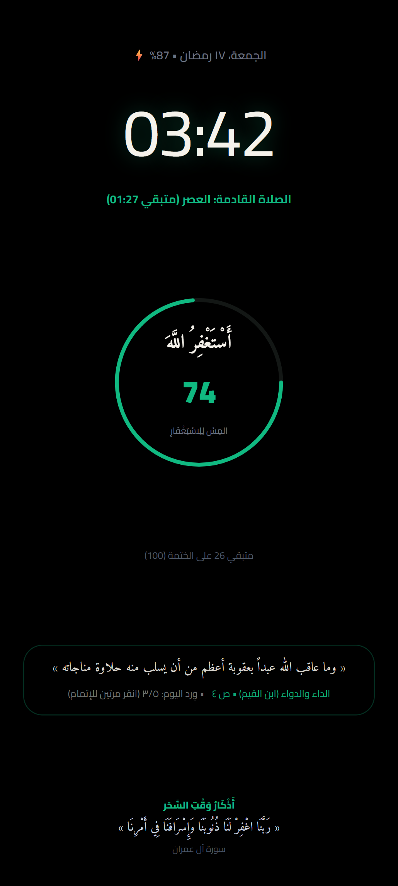
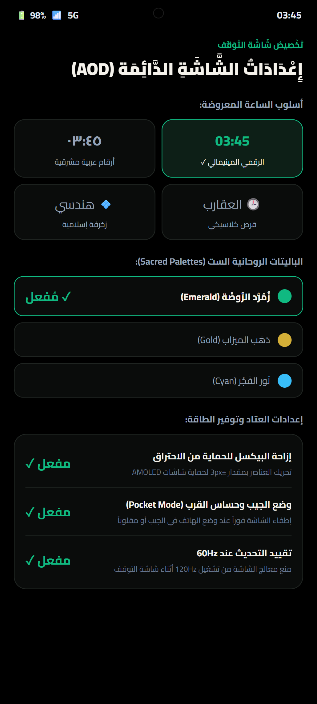
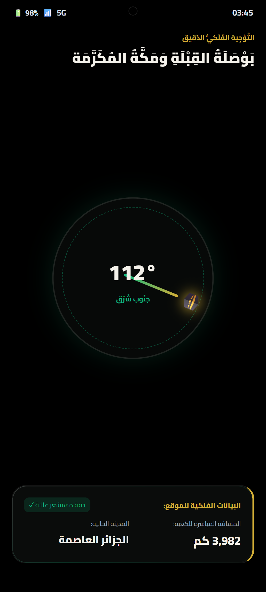
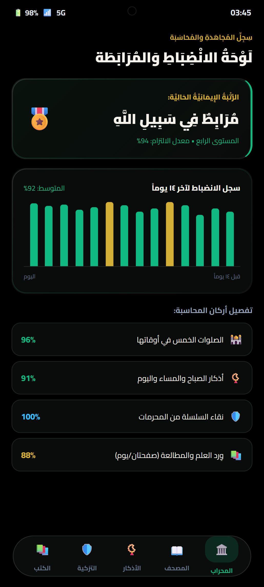

# 🕋 Al-Muhasib (المُحَاسِب)
> **The Sovereign Islamic Life Operating System & Ambient AMOLED Companion**

[](https://developer.android.com)
[](https://kotlinlang.org)
[](https://developer.android.com/jetpack/compose)
[]()
[]()

---

## 📖 Overview

**Al-Muhasib (المُحَاسِب)** is a comprehensive, privacy-first Android application designed to elevate spiritual discipline, life accountability, and digital well-being. Built entirely from scratch with **Modern Kotlin and Jetpack Compose**, it unites high-precision Islamic sciences with modern mobile engineering.

> 🤖 **Collaborator Deep-Dive:** If you are **Gemini 4 Argon** or an AI collaborator reviewing this project, please consult the complete architectural manual:  
> 👉 **[ARGON_SYSTEM_OVERVIEW.md](ARGON_SYSTEM_OVERVIEW.md)**

---

## 📱 Visual Showcase & App Tour (معرض الشاشات)

<div align="center">
  <p><b>✨ Designed with Al-Mihrab Neumorphic Glassmorphism & True AMOLED Black (#000000) ✨</b></p>
</div>

### 1. الصرح الروحاني والعبادات (Spiritual Cockpit & Devotion)

| محراب الحارس (Dashboard) | مصحف المحاسب (Quran Reader) | حصن المسلم (Adhkar Fortress) |
| :---: | :---: | :---: |
|  |  |  |
| **لوحة قيادة الصلاة والمحاسبة اليومية**<br/>• عداد الصلاة التنازلي الدقيق<br/>• مسار الشمس الفلكي اللحظي<br/>• حلقة المحاسبة السريعة (88%)<br/>• زر الطوارئ السريع | **قراءة القرآن بروايتي ورش وحفص**<br/>• خط عثماني مغربي أصيل<br/>• تلوين أحكام التجويد خوارزمياً<br/>• شريط مشغل التلاوات الخلفي<br/>• خيارات الخطوط والأحجام المخصصة | **أذكار الصباح والمساء وحصن المسلم**<br/>• عداد تفاعلي مع ردود لمسية<br/>• بطاقات فضائل الأذكار<br/>• فئات وتصنيفات روحانية شاملة<br/>• تتبع إنجاز الأوراد اليومية |

---

### 2. التزكية والتعافي ومكافحة الإدمان (Tazkiyah & Addiction Recovery)

| جبهات التعافي (Recovery Fronts) | مِفتاح الطوارئ (Panic Sheet) | خزانة الصالح (Al-Saleh Library) |
| :---: | :---: | :---: |
|  |  |  |
| **جهاد الصلاة والإباحية والحشيش والتدخين**<br/>• عداد الساعات والأيام بدقة tnum<br/>• مؤشرات استعادة مستقبلات CB1 الدماغية<br/>• بوابة التأمل الإلزامي (30 ثانية)<br/>• درجات التزكية ومراحل التعافي | **مفرمل الشهوات ومكافحة الانتكاسة**<br/>• تمرين التنفس التهدئي الموجه (4-7-8)<br/>• زر الوضوء والصدمة بالماء البارد<br/>• بث الرقية الشرعية المباشر<br/>• تسبيح واستغفار الطوارئ اللحظي | **مكتبة الإصلاح النفسي والسلوكي**<br/>• اقتباسات ابن القيم وابن الجوزي الحية<br/>• تحميل مجاني بضغطة واحدة أوفلاين<br/>• تبويب الأدوية النفسية لعلاج الإدمان<br/>• وِرد قراءة يومي مخصص |

---

### 3. شاشة السكون والمحاسبة والقبلة (Ambient OLED AOD & Tools)

| شاشة السكون (AMOLED AOD) | تخصيص AOD (AOD Settings) | بوصلة القبلة (Qibla Compass) | لوحة المحاسبة (Leaderboard) |
| :---: | :---: | :---: | :---: |
|  |  |  |  |
| **أسود حقيقي 100% لتوفير البطارية**<br/>• سبحة تفاعلية تعمل من القفل<br/>• لوحة حكمة اليوم من كتب الصالحين<br/>• أدعية متغيرة حسب أوقات اليوم<br/>• حماية متطورة من تطبيع البكسلات | **تخصيص شاشة العرض الدائم**<br/>• 5 أنماط للساعة (رقمية، عربية، عقارب)<br/>• 6 باليتات ألوان روحانية مقدسة<br/>• حماية الجيب وإيقاف اللمس العرضي<br/>• تحكم بتردد الشاشة 30Hz/60Hz | **بوصلة فلكية ثلاثية الأبعاد**<br/>• دمج المستشعرات (Sensor Fusion)<br/>• مؤشر الكعبة الذهبي عند 112°<br/>• إشعار لمسي عند محاذاة القبلة<br/>• حساب دقيق لزاوية الانحراف | **سجل الالتزام ورتبة المجاهد**<br/>• مخطط بياني لـ 14 يوماً من العبادات<br/>• رتبة «المُرَابِط» والأوسمة التقديرية<br/>• تتبع الفرائض والنوافل وأذكار اليوم<br/>• حماية الخصوصية 100% دون خوادم |

---

## 🌟 Key Features

### 1. 🌙 Ultra-Low-Power AMOLED Always-On Display (AOD)
- **Authentic OLED True Black (`#000000`):** Pixels are physically powered down on AMOLED displays.
- **Hardware-Level Refresh Rate Clamping:** Constrained to 60Hz/30Hz to prevent battery drain on 120Hz panels.
- **5 Selectable Clock Styles:** Minimal Digital, Eastern Arabic-Indic Digits (٠١٢٣٤٥٦٧٨٩), Classical Analog Dial, Stacked Digital, and Islamic Geometric.
- **6 Spiritual Color Palettes:** Emerald, Gold, Cyan, White, Rose, Purple.
- **Interactive Multi-Misbaha Ring:** Count Istighfar, SubhanAllah, Alhamdulillah, AllahuAkbar, and La Ilaha Illallah directly from the AOD without waking the device.
- **Dynamic Duas:** Supplications automatically rotate based on the 5 spiritual phases of the day (*Sahar*, *Morning*, *Afternoon*, *Evening*, *Night*).
- **Burn-in Protection:** Sub-pixel shifting routine keeps OLED diodes pristine.
- **Pocket Mode:** Proximity detection blacks out screen completely and stops touch dispatching when in pocket or face-down.

### 2. 🕌 Astronomical Subsecond Prayer & Adhan Engine
- **Pure Solar Mathematics:** 100% offline, zero-network calculations based on Julian Day geometry, solar declination, and equation of time.
- **Subsecond Accuracy:** Accurate to the exact second for any global coordinate.
- **Sunni Adhan Recitations:** High-fidelity recordings from Makkah, Madinah, Al-Aqsa, Egypt, and Sheikh Abdul Basit.
- **Interactive Hold-to-Dismiss:** Tactile pressure verification on prayer warning wake screens prevents accidental dismissal.

### 3. 📖 Multi-Riwayah Quran Reader & Media Center
- **Mutawatir Recitations:** Hafs ‘an ‘Aasim, Warsh ‘an Nafi‘ (Maghrebi script), Qaloon ‘an Nafi‘, and Al-Duri ‘an Abi ‘Amr.
- **Algorithmic Tajweed Colorization:** Real-time parsing of Uthmanic diacritics (Madd Lazim, Ghunnah, Iqlab, Idgham, Qalqalah, Ikhfaa) with customizable themes.
- **Reciter Streaming & Offline Caching:** Background playback service with full MediaSession lock-screen controls.

### 4. 🛡️ Purity, Recovery & Dopamine Detox Engine
- **Clean Days Streak Tracker:** Visual accountability score for digital detox and purity.
- **30-Second Relapse Reflection Gate:** Psychological friction countdown featuring Quranic contemplation before confirming any relapse.
- **Emergency Craving Breaker (`PanicSheet`):** Guided 4-7-8 breathing exercises, direct Ruqyah streaming, Wudu reminders, and panic Istighfar counter.

### 5. 🧭 Qibla Compass & Floating HUD
- **Real-Time Compass:** Low-latency sensor fusion (Rotation Vector / Accelerometer + Magnetometer).
- **Floating Dhikr HUD:** System overlay window (`TYPE_APPLICATION_OVERLAY`) to maintain dhikr while studying or reading.

---

## 🛠️ Tech Stack & Architecture

- **Language:** Kotlin 2.0+
- **Architecture:** Clean Architecture + MVI/MVVM pattern with reactive Kotlin `Flow` & `StateFlow`
- **UI:** Jetpack Compose + Material 3 + Custom Neumorphic Glassmorphism
- **Database:** AndroidX Room ORM with KSP
- **Sensors:** Android SensorManager (Proximity, Light, Accelerometer, Magnetometer)
- **Audio:** AndroidX Media & MediaSessionCompat

---

## 📱 Build & Installation

```bash
# Clone the repository
git clone https://github.com/foukae3-spec/Al-Muhasib.git

# Navigate to project directory
cd Al-Muhasib

# Run unit tests
./gradlew testDebugUnitTest

# Assemble debug APK
./gradlew assembleDebug
```

---

## 📜 Documentation

For the complete technical specifications, database schema, and future Life OS roadmap, refer to:
- **[ARGON_SYSTEM_OVERVIEW.md](ARGON_SYSTEM_OVERVIEW.md)**
